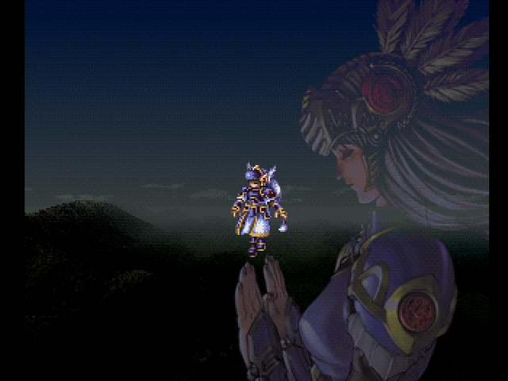
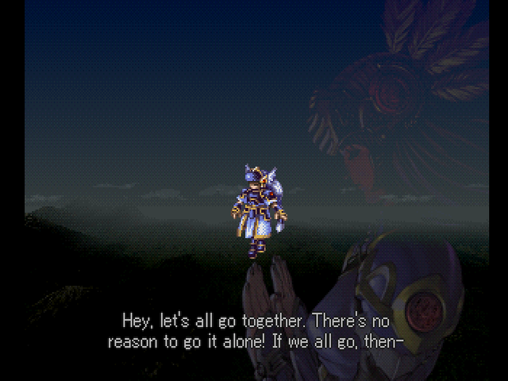
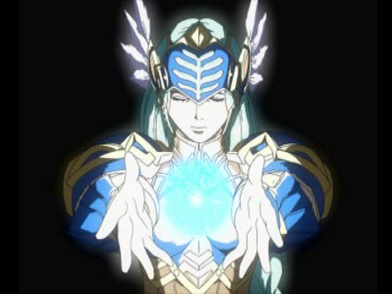
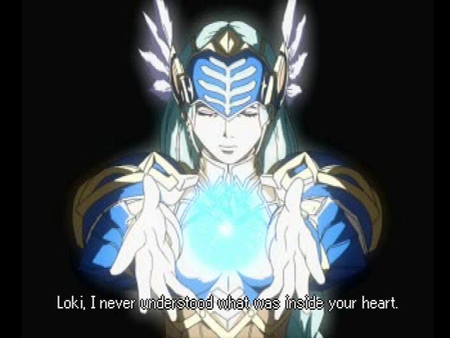
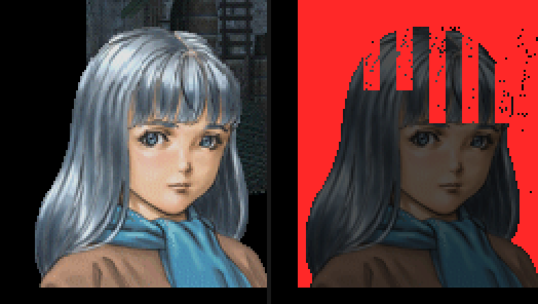
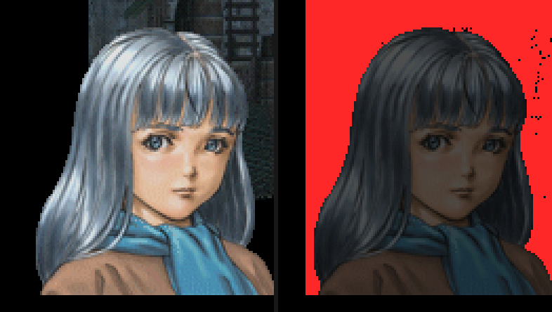
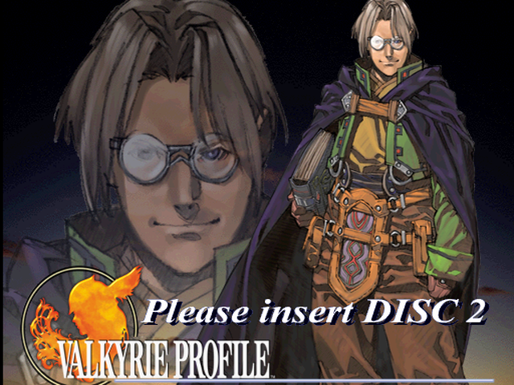
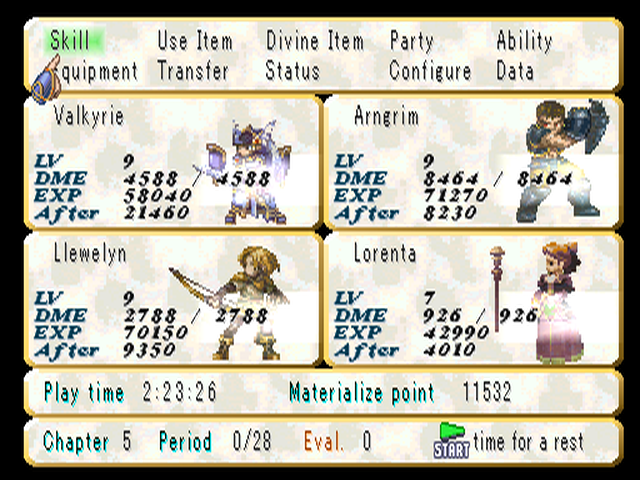

# valkyrie-undub — Valkyrie Profile (PS1, USA) Undub

English text with the original Japanese voices for the US PlayStation release of *Valkyrie Profile*
(SLUS-01156 / SLUS-01179), plus an optional conversion of the two discs into **one disc** with no disc swap.

The release is a set of [xdelta3](https://github.com/jmacd/xdelta) patches applied to your own disc images.
This repository holds the patches, the source that generates them and no game data.

- [Features](#features)
- [Requirements](#requirements)
- [Applying the patches](#applying-the-patches)
- [Generating the patches](#generating-the-patches)
- [Testing](#testing)
- [Known limitations](#known-limitations)
- [Credits](#credits)

## Features

| # | Feature | Patch |
|---|---|---|
| 1 | Japanese voices in scenes, battles, visions and FMVs | Undub |
| 2 | Voice lines are no longer cut off or dropped | Undub |
| 3 | Scene timing follows the Japanese lines | Undub |
| 4 | English subtitles for the Spiritual Concentration visions | Undub |
| 5 | English subtitles for the ending FMV | Undub |
| 6 | Mirrored dialogue portrait seam fixed | Undub |
| 7 | Both discs on one disc, no disc swap | Single disc |

### 1. Japanese voices

- Every voice the Japanese release has a match for is replaced: 1,859 (disc 1) / 1,924 (disc 2) voice clips,
  117 clips inside mixed packs and 277 whole voice sequence packs per disc.
- Text, menus, music and sound effects stay as on the US discs. The discs keep the US game ID and size.
- Memory-card saves from the US discs work on the patched discs and back. Emulator savestates do not carry over.

### 2. Voice lines are no longer cut off or dropped

- Many Japanese lines are longer than their English counterparts. The original sound driver stops a playing
  voice stream when the next line is requested, which cuts the end of such a line.
- Sound driver patch: the next line waits until the stream has finished.
- Battle engine patch: a voice request that is refused is tried again on the next frame instead of dropped.
- One clip (disc slot 1630, Brahms's opening line in the Hrist fight scene) is resampled so it loads whole and can
  play alongside another line.

### 3. Scene timing follows the Japanese lines

- Two waits in a Valkyrie scene and the line holds of the final battle use the Japanese release's values, so
  the dialogue boxes and the action stay in step with the Japanese voices.

### 4. Subtitles for the Spiritual Concentration visions

- The world-map visions are voiced but had no text for most lines, so in Japanese they could not be followed.
- 18 visions, 129 subtitle pages, drawn with the game's own font. Official lines come from the US script;
  lines that exist only in the visions are translated from the Japanese audio.

| Before (US disc) | After (undub) |
|---|---|
|  |  |

### 5. Subtitles for the ending FMV

- The four voiced lines of the ending FMV get English subtitles.

| Before (US disc) | After (undub) |
|---|---|
|  |  |

### 6. Mirrored portrait seam fixed

- A bug of the original game: a mirrored dialogue portrait draws some tile columns one texel short, which
  leaves vertical seams. They are faint at native resolution and clear with upscaling or HD texture packs.
- In each image: the in-game portrait on the left, and on the right its difference from the correct
  (flipped) portrait. Red inside the hair marks wrong pixels.

| Before (US disc) | After (undub) |
|---|---|
|  |  |

### 7. Single disc

- Most of disc 2 repeats disc 1. The single disc is disc 1 plus the 394 files only disc 2 has, under one
  file table. It is 342,269 sectors (76.06 min) and fits an 80-minute CD-R.
- At the end of Chapter 4 the game goes straight on to Chapter 5. The "Please insert DISC 2" screen is not
  shown and nothing has to be swapped.
- Saves from the two-disc version load on the single disc, and saves made on it load on the two discs.

| Before (disc 1, end of Chapter 4) | After (single disc, same point) |
|---|---|
|  |  |

## Requirements

### Disc images

Your own dumps of all four discs, matching the [Redump](http://redump.org/) entries: one single-track `.bin`
per disc. Other formats (CHD, ECM, ISO, PBP) must be converted back first. The patches only apply to images
with exactly these checksums.

| Disc image | Size (bytes) | CRC32 | MD5 | SHA-1 |
|---|---|---|---|---|
| Valkyrie Profile (USA) (Disc 1).bin | 730448880 | `dd0422d5` | `f579cb951587081019f91af9458d305b` | `fa13cbde448a47fa87b6c7829df1c5e6215f5f66` |
| Valkyrie Profile (USA) (Disc 2).bin | 747352704 | `c2132829` | `19f36bd625e676ea5d74db612d26eb6c` | `7cc65766b46273b4ee166269170ecbaa433908fd` |
| Valkyrie Profile (Japan) (Disc 1).bin | 736700496 | `6768ae3a` | `3f81ccb4fe47b37a4105df448b6e5a79` | `463af3fc81befbbf92c89c47b16dac72fc85f30d` |
| Valkyrie Profile (Japan) (Disc 2).bin | 733675824 | `9140b9db` | `af311d15269af3d9c3d19bda7ca63e25` | `b992244720af08b97e37c1fba8dc6e86790c7fbc` |

The Japanese discs are needed because the patches take the voices from them and do not contain them.

### Tools

- xdelta3, command line (tested: 3.2.2). The patches use LZMA secondary compression; a GUI patcher whose
  xdelta3 lacks LZMA cannot read them.
- About 4.5 GB of free disk space while patching.

## Applying the patches

Patches are in [`patches/`](patches) (checksums in `patches/SHA1SUMS`).

| Patch | Source | Result |
|---|---|---|
| `vpundub_disc1.xdelta` | US disc 1 + Japan disc 1, joined | Undub disc 1 |
| `vpundub_disc2.xdelta` | US disc 2 + Japan disc 2, joined | Undub disc 2 |
| `vpsingle_undub.xdelta` | Undub disc 1 + undub disc 2, joined | Undub single disc |

xdelta3 takes one source file, so each patch needs two images joined into one file, in the order shown.

### Step 1: undub (discs 1 and 2)

Linux / macOS:

```sh
cat "Valkyrie Profile (USA) (Disc 1).bin" "Valkyrie Profile (Japan) (Disc 1).bin" > source1.bin
xdelta3 -d -s source1.bin vpundub_disc1.xdelta "Valkyrie Profile (USA) (Disc 1) [Undub].bin"

cat "Valkyrie Profile (USA) (Disc 2).bin" "Valkyrie Profile (Japan) (Disc 2).bin" > source2.bin
xdelta3 -d -s source2.bin vpundub_disc2.xdelta "Valkyrie Profile (USA) (Disc 2) [Undub].bin"
```

Windows (Command Prompt):

```bat
copy /b "Valkyrie Profile (USA) (Disc 1).bin" + "Valkyrie Profile (Japan) (Disc 1).bin" source1.bin
xdelta3 -d -s source1.bin vpundub_disc1.xdelta "Valkyrie Profile (USA) (Disc 1) [Undub].bin"

copy /b "Valkyrie Profile (USA) (Disc 2).bin" + "Valkyrie Profile (Japan) (Disc 2).bin" source2.bin
xdelta3 -d -s source2.bin vpundub_disc2.xdelta "Valkyrie Profile (USA) (Disc 2) [Undub].bin"
```

### Step 2 (optional): single disc

Apply this to the two undub images from step 1.

Linux / macOS:

```sh
cat "Valkyrie Profile (USA) (Disc 1) [Undub].bin" "Valkyrie Profile (USA) (Disc 2) [Undub].bin" > source3.bin
xdelta3 -d -s source3.bin vpsingle_undub.xdelta "Valkyrie Profile (USA) (Single Disc) [Undub].bin"
```

Windows (Command Prompt):

```bat
copy /b "Valkyrie Profile (USA) (Disc 1) [Undub].bin" + "Valkyrie Profile (USA) (Disc 2) [Undub].bin" source3.bin
xdelta3 -d -s source3.bin vpsingle_undub.xdelta "Valkyrie Profile (USA) (Single Disc) [Undub].bin"
```

### Step 3: check the results and add a `.cue`

| Output | Size (bytes) | CRC32 | MD5 | SHA-1 |
|---|---|---|---|---|
| Valkyrie Profile (USA) (Disc 1) [Undub].bin | 730448880 | `c755581a` | `c2744cb02d0748d5c8c8fcf20a15d817` | `fb2874c3f0c6a3aec7b930a19ece7f7c7be9617f` |
| Valkyrie Profile (USA) (Disc 2) [Undub].bin | 747352704 | `2fbfe813` | `09a3aab639d87227eba67fb2c220d4e3` | `0ac85d3fd1427ec26c6cfd6c6174fa48c1f1bec1` |
| Valkyrie Profile (USA) (Single Disc) [Undub].bin | 805016688 | `31335181` | `03ee179d5acbf8633f20ae8edb7146ba` | `31150eccb690dd980c76efc84c639f4fef7cd78b` |

Each image needs a `.cue` file next to it with the image's file name in it, e.g.
`Valkyrie Profile (USA) (Single Disc) [Undub].cue`:

```
FILE "Valkyrie Profile (USA) (Single Disc) [Undub].bin" BINARY
  TRACK 01 MODE2/2352
    INDEX 01 00:00:00
```

The `source*.bin` files can be deleted afterwards.

### Notes

- xdelta3 checks the data as it patches. It stops with an error if an image is wrong or joined in the wrong order.
- One command for all steps on Linux/macOS, including the `.cue` files:
  `tools/apply_patches.sh <US disc 1.bin> <JP disc 1.bin> <US disc 2.bin> <JP disc 2.bin> [out dir]`
- Single disc with per-game memory cards (e.g. DuckStation): point the emulator at the card you used before,
  or copy the saves over.

## Generating the patches

### Requirements

| What | Version tested | Needed for |
|---|---|---|
| The four disc images above | Redump | everything |
| Python | 3.11 or newer (3.14) | both builders |
| numpy | 2.5 | undub builder |
| xdelta3 | 3.2.2 | writing and checking the patches |
| bash, coreutils (`cat`, `sha1sum`, `stat`) | | `tools/*.sh` |
| Free disk space | about 4 GB | `build/` |
| clang, ld.lld, llvm-objcopy, llvm-nm, llvm-objdump with the mipsel target | LLVM 23 | optional: recompiling the subtitle routines |

A different xdelta3 version can write patches with other bytes. They still apply, but will not match
`patches/SHA1SUMS`.

### Steps

1. Put the disc images here (the folders are git-ignored; symlinks work):

   ```
   roms/us/Valkyrie Profile (USA) (Disc 1)/Valkyrie Profile (USA) (Disc 1).bin + .cue
   roms/us/Valkyrie Profile (USA) (Disc 2)/Valkyrie Profile (USA) (Disc 2).bin + .cue
   roms/japan/Valkyrie Profile (Japan) (Disc 1)/Valkyrie Profile (Japan) (Disc 1).bin + .cue
   roms/japan/Valkyrie Profile (Japan) (Disc 2)/Valkyrie Profile (Japan) (Disc 2).bin + .cue
   ```

2. Run from the repository root (about 8 minutes):

   ```sh
   tools/make_patches.sh
   ```

   It writes the three images and the three patches to `build/out/` and ends with
   `OK: the generated patches match patches/SHA1SUMS`. The build is deterministic.
   After a source change, `tools/make_patches.sh --update` copies the new patches into `patches/`.

The script runs these steps, which also work one by one:

```sh
# undub discs and vpundub_disc{1,2}.xdelta (checks inputs, output and patch)
PYTHONPATH=src python3 -m vpundub build --disc 1 --disc 2 --out build/out

# single disc from the two undub discs
python3 src/vpsingle/builder.py \
    "build/out/Valkyrie Profile (USA) (Disc 1) [Undub].bin" \
    "build/out/Valkyrie Profile (USA) (Disc 2) [Undub].bin" \
    -o "build/out/Valkyrie Profile (USA) (Single Disc) [Undub].bin"

# vpsingle_undub.xdelta (decodes it again to check)
tools/make_xdelta.sh "build/out/Valkyrie Profile (USA) (Single Disc) [Undub].bin" build/out/vpsingle_undub.xdelta \
    "build/out/Valkyrie Profile (USA) (Disc 1) [Undub].bin" "build/out/Valkyrie Profile (USA) (Disc 2) [Undub].bin"
```

### Source layout

| Path | Contents |
|---|---|
| `src/vpundub/` | undub builder: disc and archive formats, voice mapping, code patches, subtitles |
| `src/vpundub/subtitles/` | subtitle text and timing (`data/`), vision overlay (`overlay.c`), ending FMV routine (`fmvsub.S`), compiled `.bin` files |
| `src/vpundub/asm/portrait_tile.s` | portrait seam fix |
| `src/vpsingle/` | single-disc builder and its code patches |
| `tools/make_patches.sh` | builds everything and checks the patches |
| `tools/make_xdelta.sh` | writes and checks one joined-source patch |
| `tools/apply_patches.sh` | applies the release patches |
| `tools/subtitle_overlay.py` | recompiles `overlay.bin` and `fmvsub.bin` (`--check` compares them with the sources) |
| `tests/` | unit tests |
| `patches/` | the release patches |

The single-disc builder also accepts the plain US discs (`python3 src/vpsingle/builder.py <disc 1.bin> <disc 2.bin>`).
More detail: [DESIGN.md](DESIGN.md), [TECHNICAL.md](TECHNICAL.md).

## Testing

```sh
PYTHONPATH=src python3 -m unittest discover -s tests
```

- Standard library `unittest` only. Tests that need the disc images skip without `roms/`.
- With the images the full run takes about 15 minutes, since it rebuilds the discs.

In-game checks done on this build:

| Check | Emulator | Result |
|---|---|---|
| Undub, full game replay from input movies: Hard 100% with A ending and Seraphic Gate (376 segments), B and C endings (99), prologue (24) | BizHawk 2.11.1 | no hang or freeze |
| Single disc layout, full game replay (376 segments; run on the US-voice single disc, same layout and patches) | BizHawk 2.11.1 | no segment worse than on the two discs |
| Single disc, Chapter 4 to 5 from a memory card | BizHawk, Beetle PSX, SwanStation, DuckStation | pass |
| Single disc, all 18 visions and the ending FMV show subtitles | BizHawk 2.11.1 | pass |
| Save made on the single disc continues on original disc 2 | BizHawk 2.11.1 | pass |

## Known limitations

- About 150 Japanese clips per disc are longer than the engine can load whole and are streamed. If another
  voice line starts while one of them plays, that line waits for the stream to end.
- Flipped background tiles (some dungeon pillars, ice cave crystals, a town sky) lose one texel as the
  portraits did. This is invisible at native resolution and can show as a thin seam with upscaling.
- Emulator savestates made on the US discs do not work on the patched discs. Use memory-card saves.

## Credits

- mugi, for the original Valkyrie Profile undub. It was used as a reference only; no data or code is reused.
- [psx-spx](https://psx-spx.consoledev.net/) (Martin Korth and maintainers) for the PlayStation hardware documentation.
- Neill Corlett's ECM tools as the reference for the sector EDC/ECC algorithm (reimplemented, no code copied).
- [xdelta3](https://github.com/jmacd/xdelta) by Joshua MacDonald.
- BizHawk, Mednafen / Beetle PSX, SwanStation, DuckStation and gamescope, used for testing.
- Vision-only lines were transcribed with faster-whisper and the Whisper large-v3 model, then corrected by hand.

## Legal

*Valkyrie Profile* © 1999 tri-Ace / Enix (now Square Enix). This is an unofficial fan project. The repository
contains no disc images. You need your own copies of all four discs. The patches hold the project's own
changes, the subtitle module (with glyphs rendered from the disc font) and one resampled voice clip per disc
(about 34 KB).
